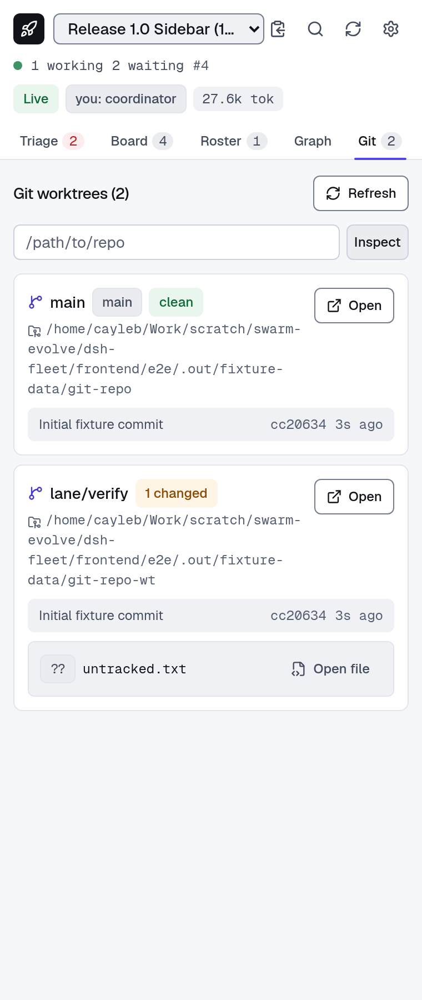
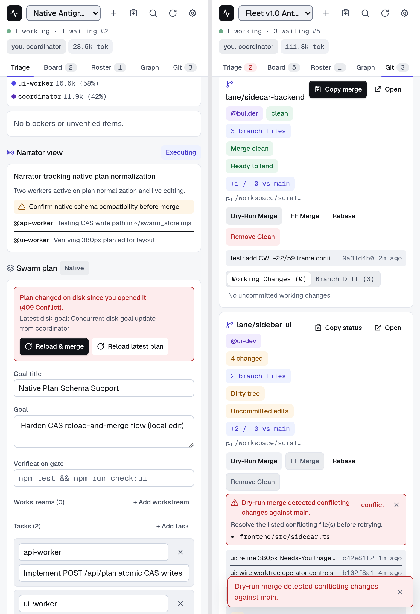
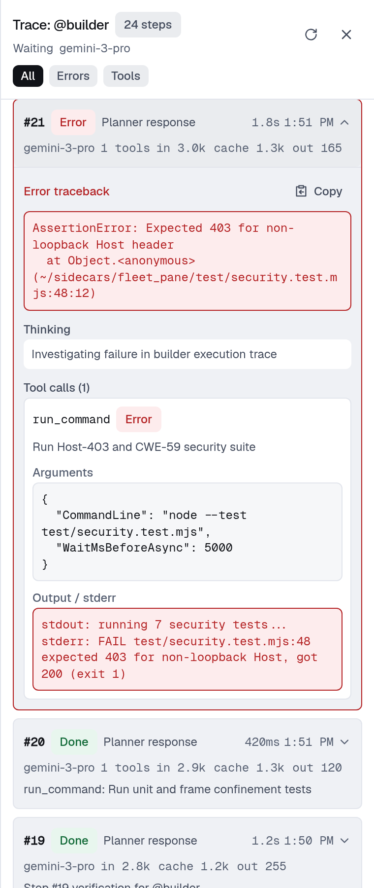
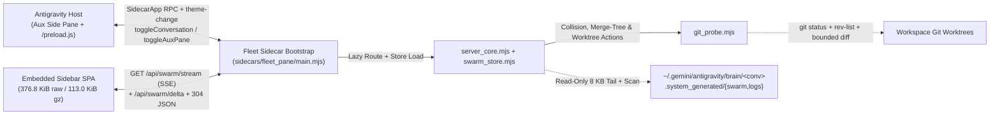

<div align="center">

# Fleet

An Antigravity sidecar plugin for multi-agent swarms. It reads native swarm boards, worker transcripts, `plan.json` milestones, and workspace git worktrees into a compact sidebar inside Antigravity.

[](https://github.com/cayleb-james2008/fleet/actions/workflows/release.yml)
[](https://github.com/cayleb-james2008/fleet/releases/latest)
[](https://cayleb-james2008.github.io/projects/fleet.html)
[](https://github.com/cayleb-james2008/fleet)
[](LICENSE)

<br />

<picture>
  <source media="(prefers-color-scheme: dark)" srcset="docs/screenshots/triage-dark.png" />
  <source media="(prefers-color-scheme: light)" srcset="docs/screenshots/triage-light.png" />
  
</picture>

</div>

---

## Sidebar gallery

Fleet lays out cleanly from a `340px` to `380px` auxiliary sidebar up to `1440px` desktop views. It listens for Antigravity `theme-change` luminance updates and keeps the manual Light and Dark switch inside Settings.

<table>
  <tr>
    <td align="center" width="25%">
      <strong>Triage and plan</strong><br />
      <picture>
        <source media="(prefers-color-scheme: dark)" srcset="docs/screenshots/triage-dark.png" />
        <source media="(prefers-color-scheme: light)" srcset="docs/screenshots/triage-light.png" />
        
      </picture>
    </td>
    <td align="center" width="25%">
      <strong>Board and pins</strong><br />
      <picture>
        <source media="(prefers-color-scheme: dark)" srcset="docs/screenshots/board-dark.png" />
        <source media="(prefers-color-scheme: light)" srcset="docs/screenshots/board-light.png" />
        
      </picture>
    </td>
    <td align="center" width="25%">
      <strong>Roster and telemetry</strong><br />
      <picture>
        <source media="(prefers-color-scheme: dark)" srcset="docs/screenshots/roster-dark.png" />
        <source media="(prefers-color-scheme: light)" srcset="docs/screenshots/roster-light.png" />
        
      </picture>
    </td>
    <td align="center" width="25%">
      <strong>Git worktrees</strong><br />
      <picture>
        <source media="(prefers-color-scheme: dark)" srcset="docs/screenshots/worktrees-dark.png" />
        <source media="(prefers-color-scheme: light)" srcset="docs/screenshots/worktrees-light.png" />
        
      </picture>
    </td>
  </tr>
</table>

<p align="center">
  <strong>Board channels, Roster controls, and conflict hardening</strong><br />
  <picture>
    <source media="(prefers-color-scheme: dark)" srcset="docs/screenshots/hardening-dark.png" />
    <source media="(prefers-color-scheme: light)" srcset="docs/screenshots/hardening-light.png" />
    
  </picture>
</p>

<p align="center">
  <strong>Forensic transcript inspector</strong><br />
  <picture>
    <source media="(prefers-color-scheme: dark)" srcset="docs/screenshots/forensic-trace-dark.png" />
    <source media="(prefers-color-scheme: light)" srcset="docs/screenshots/forensic-trace-light.png" />
    
  </picture>
</p>

---

## What it does

In Triage, Fleet collects unanswered questions, blocked posts, quota pauses, stalled worker alerts, narrator `view.json` status, and normalized native or custom `plan.json` threads, tasks, and workstreams in one inbox. Operators edit goals, gates, tasks, and workstream statuses inline through atomic CAS `POST /api/plan` updates (using content-hash ETags and 3-way `Reload & merge` recovery on `409 Conflict`, plus optional coordinator notifications). Three header actions handle exports and handoffs: Copy Handoff Digest writes a sanitized Markdown summary (active goal, gate readiness, worker state, verified commits, blockers, and worktree readiness), while Archive .md and Archive .json download a sanitized Full Swarm Archive (`fleet.swarm-archive.v1` JSON or full Markdown transcript) without `/home/` path leaks. A worker attention strip surfaces idle, unread, and stalled workers with recovery prompts, filtered board jumps, and a 1-line `activityPeek` showing transcript tail status, tool summary, and age. When a live stream stalls or polling is paused, an inline SSE banner offers a 1-click Resync. A gate readiness card tracks `[done]`, `[verified]`, `[scale-verified]`, and `[blocked]` tags with a wave velocity pill, next-gate action button, gate verdict control (`verified`, `blocked`, or `ship`), and direct target jump. A bottleneck bar summarizes working, waiting, and blocked counts, and a token burn strip plots each worker's share of total tokens.

Triage supports keyboard navigation (`j` and `k` to move, `o` or `Enter` to open chat, `p` to pin `#seq`, `r` to reply, `1` to `5` to switch tabs, `?` for help), inline activity peeks showing recent tool calls, unstick presets, `~/`-masked blocker copy buttons, and file openers through `window.sidecar.ui.toggleAuxPane`. Pressing `Ctrl+K` or `Cmd+K` opens the Command Palette across tabs, `@worker` board filters, worker chats, triage items, recent board posts, worktrees, active swarms, the New Swarm launcher, Spawn Worker, and Board Post actions. A New Swarm launcher button also sits in the header when a swarm is active.

In Board, Fleet reads `board.jsonl` with channel filter tabs (`snap.channels`), an empty-channel fallback with quick reset controls, a Channel Manager drawer (`create`, `archive`, `subscribe`, `unsubscribe`), quick filters (`All`, `Needs reply`, `[done]`, `[blocked]`, cycled with `f`), pinned posts, `#seq` quote replies, clickable `replyRefs` backlink chips (with filter recovery when jumping to hidden posts), a sticky confirmation-gated Board/Channel Composer (`channel` and `replyToSeq`), Markdown wave digests, and `.md` or `.json` board exports stripped of local `/home/` paths. In Roster, each worker card pairs duration badges, token breakdowns, context saturation, and an mtime-cached transcript tail `activityPeek` with worker recovery, filtered board jumps, an `Inspect trace` drawer (`ForensicTranscriptDrawer`), a Spawn Worker drawer, a 1-click Switch Model drawer on quota or error cards, a confirmation-gated Kill Worker flow (surfacing `409` unmerged worktree `dirtyFiles` and `ahead` warnings before Force kill), and a broadcast composer for `@all`, `working`, `waiting`, or custom worker subsets. Opening `Inspect trace` from Roster or Triage loads bounded pages from `GET /api/transcript` backwards (`All`, `Errors`, and `Tools` filters, paired `PLANNER_RESPONSE` tool arguments and `GENERIC` stderr tracebacks, `Load older steps` pagination, and scrubbed home paths and secrets). Board posts, channel operations, worker spawning, model switching, worker killing, and gate verdicts dispatch through `POST /api/control` as `[fleet-operator:<op>]` directives to the swarm coordinator with synchronous double-submit guards and missing-coordinator warnings. In Graph, a replayable `@mention` graph traces message flow across the swarm. In Git, Fleet probes workspace worktrees with `git status --porcelain=v1 -z` and `git merge-tree --write-tree`, flags overlapping `collisions` across active worktrees, shows recent commits and `Working Changes` vs `Branch Diff` hunks (`GET /api/worktrees/diff?mode=working|branch`), and runs confirmation-gated `Dry-Run Merge`, `FF Merge`, `Rebase` (with automatic `--abort` on conflict), and clean `Remove` actions (`POST /api/worktrees/action`) with inline recovery hints.

Live updates stream over `GET /api/swarm/stream` (`text/event-stream`) with ping heartbeats in standalone mode and pull incremental updates through `GET /api/swarm/delta` (`fs.watch` coalesced wakeup with a `125ms` fallback and `waitMs=20000` long-polling inside Antigravity's `SidecarApp` gateway, plus byte-offset `board.jsonl` tail caching in `swarm_store.mjs`). On startup, `main.mjs` binds the HTTP listener and answers `/api/health` immediately before lazily loading `server_core.mjs` (`swarm_store.mjs`, `git_probe.mjs`, and gzip caches) and `--jitless` V8 tuning flags after socket bind. When zero SSE clients are connected, `server_core.mjs` enters `idleSleep` and clears background polling timers until the next request or stream connection, serves cached `/api/worktrees` responses synchronously on cache hit, reads only the trailing 8 KB of each `transcript.jsonl` into a shared buffer for `activityPeek`, scans transcript pages backwards in bounded `<= 512 KiB` slices on `GET /api/transcript`, and tails full history incrementally in 32 KB chunks without retaining parsed board graphs in memory.

---

## Architecture



---

## Verified benchmarks

Measured under `#154` CPU isolation (`taskset -c 24-31`, 16 concurrent polling clients) on a 2,000-board-post and 50,000-transcript-line stress fixture:

| Metric | v1.23.0 | v1.24.0 | **v1.25.0** |
| --- | --- | --- | --- |
| Embedded sidecar UI (`/`) | `367,693 B` raw (`359.1 KiB`) / `111,231 B` gz (`108.6 KiB`) | `373,794 B` raw (`365.0 KiB`) / `113,137 B` gz (`110.5 KiB`) | **`385,808 B` raw (`376.8 KiB`) / `115,758 B` gz (`113.0 KiB`)** |
| Cold boot & RSS (`16w` audit) | `52.47 ms` / `122.0 MB` (`ETag 304`) | `55.13 ms` / `110.22 MB` (`ETag 304`) | **`51.54 ms` / `105.93 MB` (`ETag 304`)** |
| Cold audit HTTP (`16w` close) | `2,189.3 req/s` / `9.77 ms` p95 (`0/5,487` errors) | `1,387.7 req/s` / `15.49 ms` p95 (`0/3,480` errors) | **`1,373.1 req/s` / `16.91 ms` p95 (`0/3,439` errors)** |
| Simultaneous SSE (`x5` streams) | `5/5` (`0` drops) | `5/5` (`0` drops) | **`5/5` (`0` drops)** |
| Raw-TCP fuzz & backend tests | `30/30` fuzz + `29/29` unit | `30/30` fuzz + `31/31` unit | **`30/30` fuzz + `33/33` unit** |
| E2E gate, replay, and Sloplint | `61/61` + `8/8` + `22/22` live-web + `0 FAIL / 0 WARN` | `63/63` + `8/8` + `23/23` live-web + `0 FAIL / 0 WARN` | **`64/64` + `8/8` + `24/24` live-web + `0 FAIL / 0 WARN`** |

---

## Quick start

Install the plugin into `~/.gemini/config/plugins/fleet/`:

```bash
./install.sh
```

Open Antigravity Customizations (`customization://fleet`) to enable `fleet`, then open the side pane (`sidecar://fleet/fleet_pane/`) or run `/fleet` in chat to start a tracked swarm.

> Note: Fleet became an Antigravity sidecar plugin in `v1.0.0`. The older standalone Rust binary remains at git tag `v0.12.0`.

---

## Security model

The sidecar binds strictly to `127.0.0.1`, validates loopback `Host` headers (`403` otherwise), and checks `Origin` headers on mutating `POST` requests (`403`). Oversized request bodies fail early with `413 Payload Too Large` (`16 KiB` on worktree actions, `64 KiB` on plan writes and `/api/control`). `GET /api/frame` resolves paths with `realpath` inside `<appData>/brain/` and checks that each image appears on the board or `view.json`. `GET /api/transcript` resolves the member's `conversation_id` solely through `members.json` and `realpathSync` confinement under `<appData>/brain/<memberConv>/.system_generated/logs/transcript.jsonl` (`400`/`404` on traversal, symlink escape, or missing member), scrubs `/home/` paths and secret tokens across text and tool payloads, and caps returned text and output previews. `git_probe.mjs` executes git via `execFile` without shell interpolation, confines diffs and `POST /api/worktrees/action` to resolved worktrees inside the repository, refuses dirty or unmerged removals, and clears `uri` for escaping symlinks. `POST /api/control` requires `confirm: true`, resolves the swarm coordinator conversation (`404` if missing, `501` outside live SidecarApp runtime), blocks unconfirmed kills of protected roles (`coordinator`, `narrator`, `monitor`), and returns `409 Conflict` with `dirtyFiles` and `ahead` counts before killing a worker with an unmerged worktree unless `forceUnmerged: true` is set. All nudges, broadcasts, control directives, and destructive worktree actions require user confirmation, external network requests are blocked by CSP, and every response carries `X-Content-Type-Options: nosniff` and `Referrer-Policy: no-referrer`.

---

## Development and verification

```bash
cd sidecars/fleet_pane && npm test
cd ../../frontend && npm ci && npm run build:live-web
npm run check:ui -- --lints
node e2e/test-live-web.mjs
```
