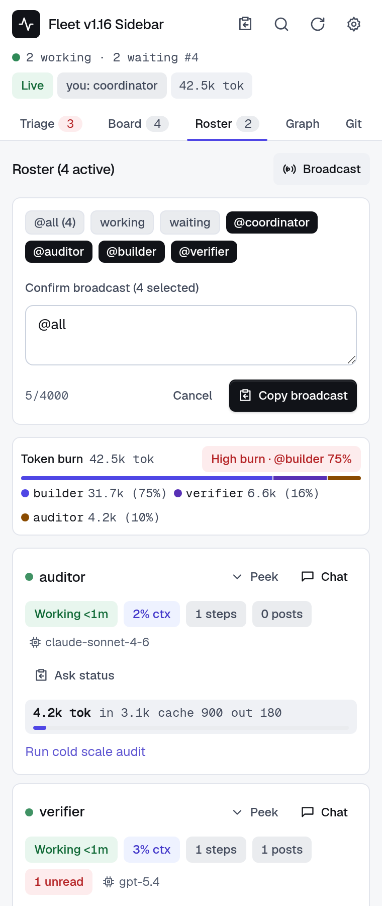
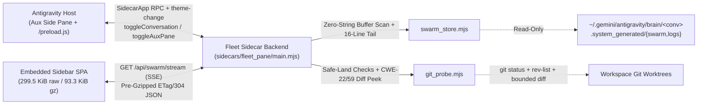

<div align="center">

# Fleet

An Antigravity sidecar plugin for multi-agent swarms. It reads native swarm boards, worker transcripts, `plan.json` milestones, and workspace git worktrees into a compact sidebar inside Antigravity.

[](https://github.com/cayleb-james2008/fleet/actions/workflows/release.yml)
[](https://github.com/cayleb-james2008/fleet/releases/latest)
[](https://cayleb-james2008.github.io/projects/fleet.html)
[](https://github.com/cayleb-james2008/fleet)
[](LICENSE)

<br />

<picture>
  <source media="(prefers-color-scheme: dark)" srcset="docs/screenshots/triage-dark.png" />
  <source media="(prefers-color-scheme: light)" srcset="docs/screenshots/triage-light.png" />
  
</picture>

</div>

---

## Sidebar gallery

Fleet lays out cleanly from a `340px` to `380px` auxiliary sidebar up to `1440px` desktop views. It listens for Antigravity `theme-change` luminance updates and keeps the manual Light and Dark switch inside Settings.

<table>
  <tr>
    <td align="center" width="25%">
      <strong>Triage and plan</strong><br />
      <picture>
        <source media="(prefers-color-scheme: dark)" srcset="docs/screenshots/triage-dark.png" />
        <source media="(prefers-color-scheme: light)" srcset="docs/screenshots/triage-light.png" />
        
      </picture>
    </td>
    <td align="center" width="25%">
      <strong>Board and pins</strong><br />
      <picture>
        <source media="(prefers-color-scheme: dark)" srcset="docs/screenshots/board-dark.png" />
        <source media="(prefers-color-scheme: light)" srcset="docs/screenshots/board-light.png" />
        
      </picture>
    </td>
    <td align="center" width="25%">
      <strong>Roster and telemetry</strong><br />
      <picture>
        <source media="(prefers-color-scheme: dark)" srcset="docs/screenshots/roster-dark.png" />
        <source media="(prefers-color-scheme: light)" srcset="docs/screenshots/roster-light.png" />
        
      </picture>
    </td>
    <td align="center" width="25%">
      <strong>Git worktrees</strong><br />
      <picture>
        <source media="(prefers-color-scheme: dark)" srcset="docs/screenshots/worktrees-dark.png" />
        <source media="(prefers-color-scheme: light)" srcset="docs/screenshots/worktrees-light.png" />
        
      </picture>
    </td>
  </tr>
</table>

---

## What it does

In **Triage**, Fleet pulls unanswered questions, blocked posts, quota pauses, stalled worker alerts, and `plan.json` workstreams into a single inbox. A worker attention strip surfaces idle, unread, and stalled workers with 1-click recovery prompts and direct board jumps filtered to that member. A gate readiness card tracks `[done]`, `[verified]`, `[scale-verified]`, and `[blocked]` tags alongside a wave velocity pill, next-gate action button, and direct target jump. A bottleneck bar summarizes working, waiting, and blocked counts, and a token burn strip plots each worker's share of total tokens.

Each triage item includes keyboard shortcuts (`j` and `k` to move, `o` or `Enter` to open chat, `p` to pin `#seq`, `r` to reply, `1` to `5` to switch tabs, `?` for help), inline activity peeks showing recent tool calls, unstick presets, `~/`-masked blocker copy buttons, and direct file openers through `window.sidecar.ui.toggleAuxPane`. Press `Ctrl+K` or `Cmd+K` anywhere to search across tabs, `@worker` board filters, worker chats, triage items, recent board posts, worktrees, and active swarms.

In **Board**, Fleet reads `board.jsonl` with quick filters (`All`, `Needs reply`, `[done]`, `[blocked]`, cycled with `f`), pinned posts, `#seq` quote replies, Markdown wave digests, and `.md` or `.json` board exports stripped of local `/home/` paths. In **Roster**, you can inspect worker duration badges, token breakdowns, and context saturation, recover stalled or idle workers in one click, jump straight to a worker's filtered board posts, or open a confirmation-gated broadcast composer to nudge `@all`, `working`, `waiting`, or custom worker subsets. In **Graph**, a replayable `@mention` graph traces message flow across the swarm. In **Git**, Fleet probes workspace worktrees with `git status --porcelain=v1 -z`, computes ahead/behind divergence against `main` (`Ready to land`, `Needs rebase`, `Uncommitted edits`, or `Landed / clean`) with 1-click copyable merge/rebase/cleanup commands, and shows bounded inline diffs (`GET /api/worktrees/diff`).

Live updates stream over `GET /api/swarm/stream` (`text/event-stream`) in standalone mode and fall back to polling inside Antigravity's `SidecarApp` gateway. On startup, `main.mjs` binds the HTTP listener before loading `swarm_store.mjs`, answers `/api/health` immediately, defers `--jitless` V8 tuning flags until after socket bind, serves cached `/api/worktrees` responses synchronously on cache hit, and tails `transcript.jsonl` incrementally in 32 KB chunks without retaining parsed board graphs in memory.

---

## Architecture



---

## Verified benchmarks

Measured under `#154` CPU isolation (`taskset -c 24-31`, 16 concurrent polling clients) on a 2,000-board-post and 50,000-transcript-line stress fixture:

| Metric | v1.14.0 | v1.15.0 | **v1.16.0** |
| --- | --- | --- | --- |
| Embedded sidecar UI (`/`) | `301,836 B` raw / `94,150 B` gz | `304,263 B` raw / `94,884 B` gz | **`306,653 B` raw (`299.5 KiB`) / `95,549 B` gz (`93.3 KiB`)** |
| Peak RSS (`VmHWM`, `--jitless` 2k/50k) | `63.05 MB` (`64,564 KB`) | `63.01 MB` (`64,524 KB`) | **`62.39 MB` (`63,888 KB`)** |
| Peak RSS (`VmHWM`, cold default audit) | `101.73 MB` (`16w`) | `102.42 MB` (`16w`) | **`100.86 MB` (`103,284 KB`, `16w`)** |
| Throughput (`--jitless` keep-alive) | `3,872.7 req/s` | `7,068.5 req/s` | **`6,921.0 req/s` (`2k/50k`)** |
| Cold audit HTTP (`16w` close) | `1,272.3 req/s` / `15.30 ms` p95 | `1,168.8 req/s` / `15.50 ms` p95 | **`1,364.4 req/s` / `14.60 ms` p95 (`0` errors)** |
| Simultaneous SSE (`x5` streams) | `5/5` (`0` drops) | `5/5` (`0` drops) | **`5/5` (`0` drops)** |
| E2E gate, replay, and Sloplint | `44/44` + `8/8` + `0 FAIL` | `46/46` + `8/8` + `0 FAIL` | **`48/48` + `8/8` + `0 FAIL / 0 REFLEX / 0 WARN`** |

---

## Quick start

Install the plugin into `~/.gemini/config/plugins/fleet/`:

```bash
./install.sh
```

Open Antigravity Customizations (`customization://fleet`) to enable `fleet`, then open the side pane (`sidecar://fleet/fleet_pane/`) or run `/fleet` in chat to start a tracked swarm.

> Note: Fleet became an Antigravity sidecar plugin in `v1.0.0`. The older standalone Rust binary remains at git tag `v0.12.0`.

---

## Security model

The sidecar binds strictly to `127.0.0.1`, validates loopback `Host` headers (`403` otherwise), and checks `Origin` headers on mutating `POST` requests (`403`). Oversized request bodies fail early with `413 Payload Too Large`. `GET /api/frame` resolves paths with `realpath` inside `<appData>/brain/` and checks that each image appears on the board or `view.json`, while `git_probe.mjs` clears `uri` for escaping symlinks inside worktrees. All nudges and broadcasts require explicit user confirmation (`confirm: true`), external network requests are blocked by CSP, and every response carries `X-Content-Type-Options: nosniff` and `Referrer-Policy: no-referrer`.

---

## Development and verification

```bash
cd sidecars/fleet_pane && npm test
cd ../../frontend && npm ci && npm run build:live-web
npm run check:ui -- --lints
node e2e/test-live-web.mjs
```
